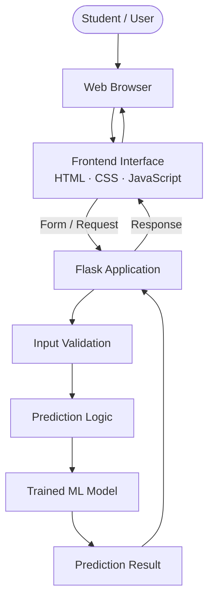
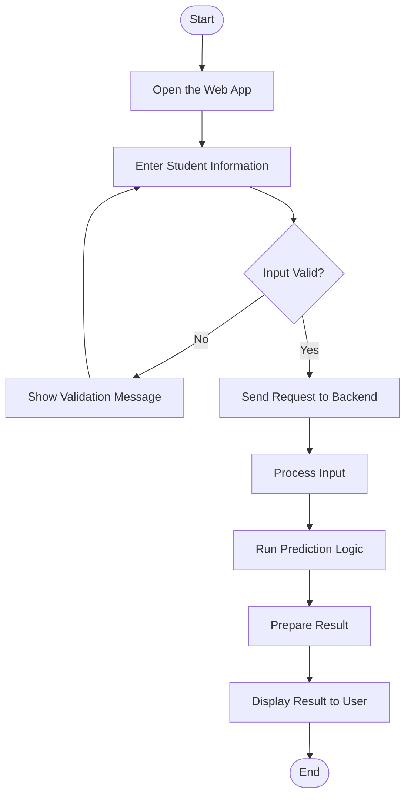

<div align="center">

# 🎯 SmartPlacementPredictions

### AI-Based Student Placement Prediction System

A student-focused web application project exploring how Artificial Intelligence and Machine Learning can support placement prediction.

[](https://www.python.org/)
[](https://flask.palletsprojects.com/)
[](https://developer.mozilla.org/en-US/docs/Web/HTML)
[](https://developer.mozilla.org/en-US/docs/Web/JavaScript)
[](https://github.com/adityaraj150107-star)

</div>

---

## 📌 About the Project

**SmartPlacementPredictions** is an AI/ML-focused student placement prediction project developed with Python and web technologies. It aims to provide a browser-based interface through which relevant student information can be submitted for placement-related analysis.

The project brings together a web interface, backend processing, and prediction logic. The exact prediction output depends on the model, input features, and implementation included in the repository.

## ✨ Project Highlights

- 🤖 **Placement prediction concept** — explores applying machine learning to student placement outcomes.
- 🌐 **Web application** — provides a browser-based interface for interacting with the project.
- 🐍 **Python backend** — supports application logic and request processing.
- ⚙️ **Flask** — used for the web application layer.
- 🧩 **Frontend technologies** — HTML, CSS, and JavaScript for page structure, styling, and interaction.
- 🔐 **Authentication and email verification** — include these flows only where configured in the current code.
- 📈 **Extendable project** — can be improved with model evaluation, visualizations, and additional student insights.

## 🧰 Technology Stack

| Technology | Role |
| --- | --- |
| Python | Main application language |
| Flask | Web server and request handling |
| HTML5 | Web page structure |
| CSS3 | Layout, styling, and responsive design |
| JavaScript | Client-side interaction |
| Machine Learning | Placement prediction logic, when a trained model is configured |
| Git & GitHub | Version control and source hosting |

---

## 🏗️ System Architecture

The diagram below shows the high-level intended architecture. The exact modules and data flow should match the implementation in the source code.



## 🔄 Application Workflow



> **Note:** These are documentation diagrams of the intended flow, not proof that every block is already implemented. Authentication, email OTP, database storage, and the ML model should be described as active features only if they are present and configured in the code.

---

## 📂 Repository Structure

Your repository structure may evolve as the project grows. A typical layout for this kind of application is:

```text
SmartPlacementPredictions/
├── frontend/          # UI assets and pages, if separated
├── backend/           # Backend modules, if separated
├── app.py             # Application entry point, if present
├── requirements.txt   # Python dependencies, if present
├── .gitignore
└── README.md
```

Check the actual filenames in the repository before relying on the example paths above.

## 🚀 Getting Started

### 1. Clone the repository

```bash
git clone https://github.com/adityaraj150107-star/SmartPlacementPredictions.git
cd SmartPlacementPredictions
```

### 2. Create a virtual environment

On Windows PowerShell:

```powershell
python -m venv venv
.\venv\Scripts\Activate.ps1
```

### 3. Install dependencies

If the repository contains a `requirements.txt` file:

```powershell
pip install -r requirements.txt
```

### 4. Configure environment variables

If your local setup uses email credentials or API keys, configure them locally using the method expected by the application. **Never commit passwords, Gmail App Passwords, API keys, or a real `.env` file to GitHub.**

### 5. Run the application

Use the actual entry-point file and command configured in your project. For example, if the Flask entry point is `app.py`:

```powershell
python app.py
```

Open the local address printed in the terminal. A typical Flask development address is `http://127.0.0.1:5000/`, but use the URL shown by your application.

---

## 🖼️ Screenshots

Screenshots make it easier for visitors to understand the interface. Add real screenshots to the repository and update the paths below when those files are available.

```markdown


```

## 🔐 Security Checklist

- Keep `.env` and other secret files out of Git.
- Never publish passwords, API keys, or email app passwords.
- Exclude `venv/`, `__pycache__/`, and generated temporary files from commits.
- Validate submitted data on the backend.
- Use secure password hashing and session handling if accounts are implemented.

## 🚀 Possible Future Improvements

- Document the dataset and student features used by the model.
- Report appropriate evaluation metrics based on actual test results.
- Add charts to make prediction results easier to understand.
- Improve accessibility and mobile responsiveness.
- Add screenshots and a reproducible demo workflow.
- Document known limitations and responsible use of predictions.

## 👨‍💻 Developer

**Aditya Raj**

- GitHub: [@adityaraj150107-star](https://github.com/adityaraj150107-star)
- Portfolio: [Aditya Raj Portfolio](https://adityaraj150107-star.github.io/Aditya_Raj_Portfolio/)
- Repository: [SmartPlacementPredictions](https://github.com/adityaraj150107-star/SmartPlacementPredictions)

---

⭐ If you find this project interesting, consider starring the repository.

<div align="center">

**Built with Python and a focus on AI/ML-based placement prediction.**

</div>
