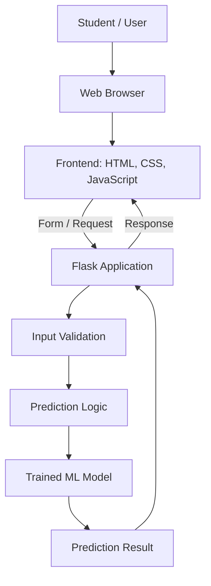
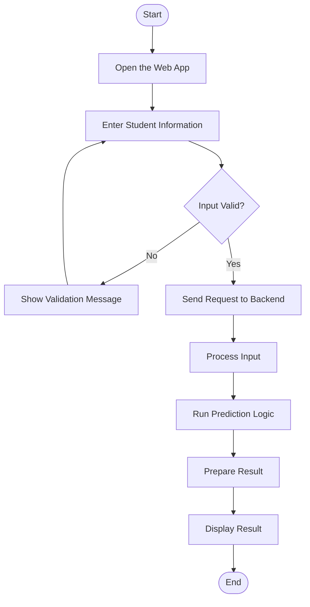

<div align="center">

# 🎯 SmartPlacementPredictions
### AI-Based Student Placement Prediction System

**A Python and Flask web application exploring machine-learning-driven insights for student placement outcomes.**

<p>
  <a href="https://github.com/adityaraj150107-star/SmartPlacementPredictions">
    
  </a>
  
  
  
  
</p>

<p>
  <a href="#-overview">Overview</a> ·
  <a href="#-features">Features</a> ·
  <a href="#-getting-started">Getting Started</a> ·
  <a href="#-architecture">Architecture</a> ·
  <a href="#-author">Author</a>
</p>

</div>

---

## 📌 Overview

**SmartPlacementPredictions** is an AI/ML-focused student placement prediction project built with Python and web technologies. It aims to provide a browser-based experience for entering student-related information and exploring placement-related prediction results.

The project brings together a web interface, Flask request handling, and prediction logic. Actual outputs depend on the trained model, available input features, and the implementation configured in the repository.

## ✨ Features

- 🎯 **Placement prediction workflow** — designed around student placement-related inputs and results.
- 🌐 **Web-based interface** — interact with the application through a browser.
- 🐍 **Python backend** — handles application logic and request processing.
- ⚡ **Flask application layer** — connects the UI with backend processing.
- 🎨 **Frontend experience** — HTML, CSS, and JavaScript for page structure, styling, and interaction.
- 🔐 **Account and email verification flows** — available where implemented and correctly configured in the codebase.
- 🧩 **Expandable foundation** — can be extended with model evaluation, visual analytics, and additional student insights.

> **Scope note:** Feature availability depends on the code and configuration in the repository. A model's accuracy or a particular authentication flow should only be claimed after testing the actual implementation.

## 🧰 Technology Stack

| Technology | Purpose |
|---|---|
| Python | Core application logic |
| Flask | Web application and request handling |
| HTML5 | Page structure |
| CSS3 | Styling and responsive layouts |
| JavaScript | Client-side interactions |
| Machine Learning | Prediction logic, when a trained model is configured |
| Git & GitHub | Version control and source hosting |

## 🏗️ Architecture

The high-level intended flow connects the browser UI to the Flask application and prediction logic.



## 🔄 Typical User Workflow



These diagrams describe the intended application flow; they do not guarantee every component is enabled in every local setup.

## 🚀 Getting Started

### Prerequisites

- Python installed on your system
- Git recommended
- VS Code recommended for development

### 1. Clone the repository

```powershell
git clone https://github.com/adityaraj150107-star/SmartPlacementPredictions.git
cd SmartPlacementPredictions
```

### 2. Create and activate a virtual environment

On Windows PowerShell:

```powershell
python -m venv venv
.\venv\Scripts\Activate.ps1
```

### 3. Install dependencies

If the project includes a root-level `requirements.txt`:

```powershell
python -m pip install -r requirements.txt
```

If dependencies are stored in another directory, use the requirements file at the path present in your checkout.

### 4. Configure local settings

If the application uses environment variables, set them using the configuration format expected by the code. For email delivery, use the required SMTP settings and a provider-approved credential such as a Gmail App Password where applicable.

**Never commit real passwords, API keys, tokens, Gmail App Passwords, or populated `.env` files to GitHub.**

### 5. Run the application

Use the entry point present in your project. If the Flask entry point is `app.py`, run:

```powershell
python app.py
```

Open the local URL printed in the terminal. Flask commonly uses [http://127.0.0.1:5000](http://127.0.0.1:5000), but follow the address shown by your application.

## 🖼️ Screenshots

Want to make the repository even more engaging? Add genuine screenshots of the running application—for example, the login page, prediction form, and result page—and reference the real image paths here.

```markdown


```

The screenshot paths above are examples; add the images before using these links.

## 🔐 Security & Responsible Use

- Keep `.env`, credentials, tokens, and API keys out of version control.
- Exclude virtual environments and generated files such as `venv/` and `__pycache__/`.
- Validate all user-submitted data on the backend.
- If accounts are implemented, use secure password hashing and appropriate session management.
- Treat predictions as estimates, not guarantees of employment or a student's future outcome.
- Document the dataset, limitations, and evaluation metrics before making claims about model performance.

## 💡 Potential Enhancements

- Document the dataset, input features, and model-training process.
- Add verified evaluation metrics using a held-out test set.
- Introduce clear charts and explainable prediction insights.
- Improve accessibility and mobile usability.
- Include screenshots from the real running application.
- Add tests and document known limitations.

## 👨‍💻 Author

<div align="center">

### Aditya Raj

[](https://github.com/adityaraj150107-star)
[](https://adityaraj150107-star.github.io/Aditya_Raj_Portfolio/)

[**View SmartPlacementPredictions repository →**](https://github.com/adityaraj150107-star/SmartPlacementPredictions)

</div>

---

<div align="center">
  <sub>Built with Python and a focus on AI/ML-based placement prediction.</sub>
</div>
